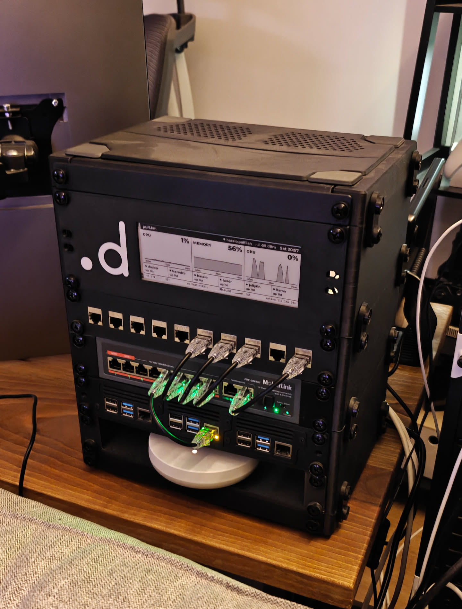
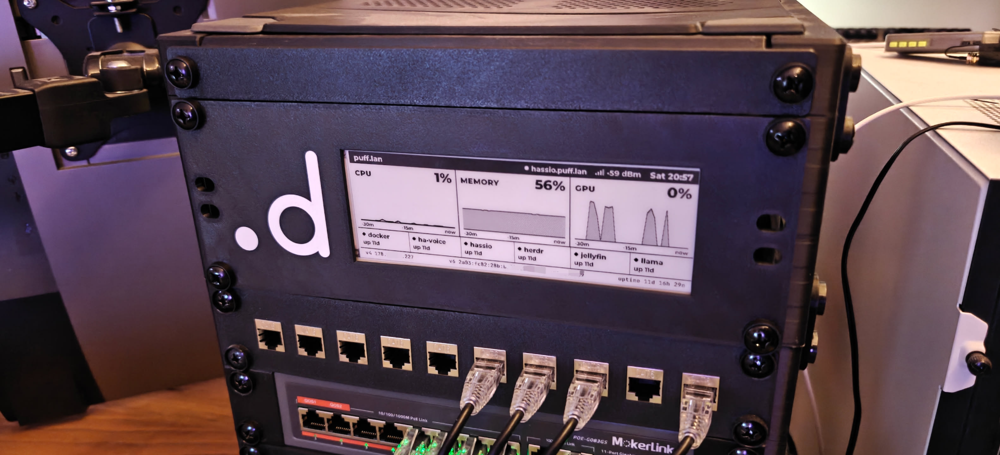
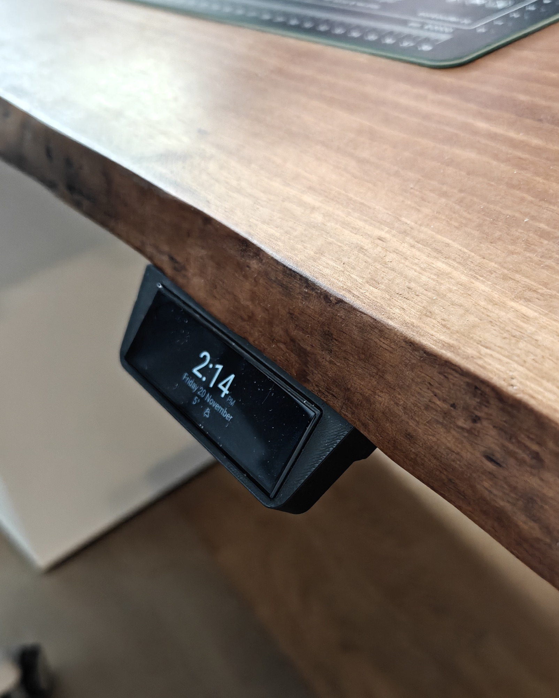
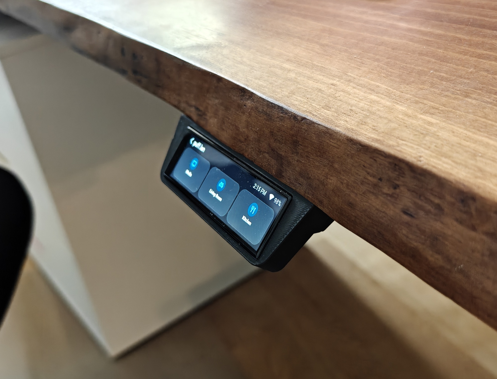

I've recently added two little status displays around the flat. One lives in the front of my homelab rack and shows how everything is doing, while the other sits just under the edge of my desk with a few Home Assistant controls. Both are ESP32-based, but for the rack I built a custom e-ink dashboard from scratch, while for the desk I adapted an existing project, Tessera, for a very wide, very short LilyGO display. Which sounded like it would mostly be a matter of changing a few dimensions. We'll get to that..

I've also been stumbling across more and more projects doing similar things, including some that give old Android phones and even Amazon Echo Shows a new job. So this is partly a write-up of my own builds, and partly a collection of things to look at if you want a little display of your own.

## An e-ink dashboard for the homelab

The first display is an [Elecrow CrowPanel ESP32-S3 with a 5.79-inch e-paper screen](https://www.elecrow.com/wiki/CrowPanel_ESP32_E-paper_5.79-inch_HMI_Display.html). It's a black-and-white panel with a resolution of 792 x 272, which happens to work nicely across the front of a small rack.

I wanted a quick overview of the machines sitting right behind it. CPU, memory and GPU usage along the top, a handful of service status tiles underneath, and some network information and uptime along the bottom. The little charts show the last 30 minutes, which gives the current percentages a bit of context.

The software is custom, built with [ESPHome](https://esphome.io/) and [LVGL](https://lvgl.io/). ESPHome handles the device and its connection to Home Assistant, while LVGL handles drawing the interface. The e-paper driver comes from [ESPBoards' CrowPanel component](https://github.com/ESPBoards/esphome-lvgl-crowpanel-epaper-5.79-4.2).

Home Assistant is the middleman for the data. In my setup that includes the Proxmox integration, but the panel mostly just cares about entity states. You point it at the sensors you want to display, give the service tiles some names, and it renders them. The one gotcha is GPU usage. The Proxmox integration doesn't provide that, so you'll need a separate data source for it.

E-ink is a good fit here because these are numbers I want to glance at occasionally. I don't need the CPU graph animating at 60 fps beside the sofa. The firmware batches the normal updates into a partial refresh once a minute, with a faster redraw when a service changes state or the Home Assistant connection drops. Periodic full refreshes clear the ghosting.

One detail I wanted to get right was what happens when the data stops arriving. E-paper happily keeps showing its last image, so a disconnected display can look reassuringly healthy. Mine shows an offline banner after losing its connection for two minutes, as long as the panel itself still has power. Missing readings also show as missing, rather than quietly becoming `0%`.

There is a similar distinction with the service tiles: a Proxmox guest being "running" doesn't necessarily mean the application inside it is healthy. If you want to know whether Jellyfin is actually responding, use an application health check for that tile. Otherwise you're just displaying whether its container is up.

### The mount and the files

The panel sits in a 3D-printed 2U mount for my 10-inch rack. The model files are in the same repository as the firmware, with and without the `.d` logo, so you can print a version that doesn't have my initial on it haha.

Everything is in [crowpanel-homelab-dashboard](https://github.com/ndom91/crowpanel-homelab-dashboard). If you want to poke around, these are the useful starting points:

- [`ha-stub.yaml.example`](https://github.com/ndom91/crowpanel-homelab-dashboard/blob/main/ha-stub.yaml.example) is the device configuration to start from in ESPHome Device Builder.
- [`packages/ui.yaml`](https://github.com/ndom91/crowpanel-homelab-dashboard/blob/main/packages/ui.yaml) defines the layout, and [`include/dashboard.h`](https://github.com/ndom91/crowpanel-homelab-dashboard/blob/main/include/dashboard.h) contains the chart and status helpers.
- [`packages/data_ha.yaml`](https://github.com/ndom91/crowpanel-homelab-dashboard/blob/main/packages/data_ha.yaml) connects the Home Assistant entities, while [`packages/refresh.yaml`](https://github.com/ndom91/crowpanel-homelab-dashboard/blob/main/packages/refresh.yaml) handles redraws and the stale-data banner.
- [`assets/`](https://github.com/ndom91/crowpanel-homelab-dashboard/tree/main/assets) contains the STEP and 3MF files for the rack mount.

The README walks through the initial USB flash and switching from demo data to your own entities. Your Wi-Fi credentials, API key and entity configuration stay in your local device YAML.

## A tiny control panel under the desk

For the second display I used a LilyGO T-Display S3 Long. It's a 3.4-inch color touchscreen with a 640 x 180 resolution in landscape. Basically a little strip of screen, which fits quite neatly under the edge of my desk.

This time I started with [Tessera](https://tessera-maxgramser.on-forge.com), by Max Gramser. It provides firmware for ESP32 LCD touchscreens and a Screen Manager app inside Home Assistant, where you can arrange tiles and send layouts to the display. Lights, switches, sensor values and other controls already have tiles, which saves quite a bit of work compared with building every widget yourself.

The catch was the shape of my screen. At 180 pixels tall, the header, navigation and tile labels all compete for a pretty small amount of space. A layout that works on a square panel doesn't automatically work on this one, even if the total number of pixels sounds reasonable.

My version uses Tessera's compact styling and a single row of tiles. Hiding the page-navigation bar buys back a useful chunk of height too. I've also been working on tile orientation so the icon, name and state can fit more comfortably on short displays. That part is still in progress.

Then there was touch input, which turned into its own little adventure. The examples I started from used an `axs15231` touchscreen driver, but my board's touch controller needed the CST3530 protocol. I had to check the I2C bus, try a CST3530 component and sort out the coordinate transforms. After all that, touch finally worked in both the normal and flipped screen orientations. A good reminder that the display controller and touchscreen controller are two separate things, even when they're attached to the same tiny board.

I'm keeping this as an experimental port for now. It works on my desk, but I haven't tested every dialog, gesture or standby mode on this hardware yet, so YMMV.

If you want to dig in, here's where to look:

- [My Tessera fork's `lilygo-s3-long` branch](https://github.com/ndom91/homeassistant_espscreen/tree/lilygo-s3-long) has all of the work.
- The [LilyGO notes](https://github.com/ndom91/homeassistant_espscreen/blob/lilygo-s3-long/docs/open-issues/lilygo-s3-long.md) cover the hardware investigation and touch results.
- [`packages/looks/compact.yaml`](https://github.com/ndom91/homeassistant_espscreen/blob/lilygo-s3-long/packages/looks/compact.yaml) and [`docs/RESPONSIVE.md`](https://github.com/ndom91/homeassistant_espscreen/blob/lilygo-s3-long/docs/RESPONSIVE.md) are the places to start for the layout side.

Some of the latest layout work is still local, so the branch isn't yet a complete install-and-go package for this board.

> [!TIP]
> If you just want a working Tessera panel, I'd start with one of the screens on the [upstream compatibility list](https://tessera-maxgramser.on-forge.com) and save yourself the touch-controller investigation.

## You might already own the display

I've been down this road before with my [MagicMirror](/blog/magicmirror-list), which started with an old monitor. These little panels scratch a similar itch, just with fewer things on each screen.

It feels like I'm seeing a lot more of them lately. Some are dedicated e-ink dashboards, some are tiny touch panels, and others are old phones propped up beside a keyboard. The part I particularly like is giving existing hardware another use. An old phone already has a screen, Wi-Fi, touch input and a case, which is quite a lot of the project taken care of.

I haven't built out all of the following myself, but they're the projects I'd look at depending on what hardware you have and what you want it to show.

### An old Android phone or tablet for Home Assistant

[Kiosk Satellite](https://github.com/jxlarrea/kiosk-satellite) turns an Android device into a dedicated Home Assistant kiosk. Alongside showing your dashboard, it can act as an Assist voice satellite, play music and show photo screensavers. It currently requires Android 7 or newer.

This is where I'd start for a spare tablet that you want to leave in the kitchen or hallway. You get to reuse the dashboard you've already made in Home Assistant, and the device's microphone and speakers can have a job too. It's free for personal, non-commercial use, so check the project's license if you want to do more with it.

### An old Android phone beside your computer

[PhoneBox](https://github.com/ersinkoc/phonebox) is more focused on the computer sitting next to it. An Android app pairs with a desktop agent on Windows, Linux or macOS over USB or Wi-Fi, and you build the panel in a browser-based editor.

It can show CPU/GPU stats, music, timers and coding-session information, as well as provide touch shortcuts and controls. Android 5 and newer is supported, with Android 6 or later recommended, and it doesn't require root. If you've got an old phone in a drawer and a desk with some free space, this one's a pretty fun way to turn it into a little PC stats screen or Stream Deck-style control panel.

### A small ESP32 LCD touchscreen

[Tessera for LCD displays](https://tessera-maxgramser.on-forge.com) is the project behind my desk panel. On supported hardware, its Home Assistant editor lets you rearrange the tiles without rebuilding the firmware every time.

For a small dedicated Home Assistant control panel, this is the one I'd reach for, especially if you enjoy printing an enclosure that fits a particular spot. Just pick a supported board first. My unusually short LilyGO is very much the tinkering route.

### An e-ink dashboard

[Tesserae](https://tesserae.ink) is a separate project from Tessera, despite the very similar name. It lets you compose dashboards for e-ink panels and have a server render and refresh them on a schedule. You can self-host it, including as a Home Assistant app.

I'd look at this for a calendar, weather display or household information board where the content can update less frequently. Its hardware list also includes Kindle clients, which is another interesting reuse option if you have an old e-reader around. Check the supported models before digging one out of a drawer.

### An Echo Show 5 or Show 8

[The Stock Pot's bedside-clock project](https://github.com/TheStockPot/bedside-clock) provides a Home Assistant dashboard designed for the Echo Show 5 and Show 8. It has a setup wizard and pages for things like a clock, weather, cameras, calendars and timers.

Heads up though, that's only the dashboard part of the conversion. Installing a Home Assistant dashboard by itself doesn't replace Amazon's software. You still need to get the Echo running your own kiosk software, which is a separate, model-specific step.

Kiosk Satellite has guides for that on devices including the [Show 5 second generation](https://kiosksatellite.com/docs/echo-show-5/) and [Show 8 first generation](https://kiosksatellite.com/docs/echo-show-8/), using custom LineageOS images. Check your exact generation and its installation requirements first.

This is probably the reuse option I'm most curious about. The screen, speaker and stand are already there, and being able to give the whole thing a job in Home Assistant is pretty appealing.

## What I'd start with

For me, the location helped decide what each display should do. The rack gets a quiet overview of the machines inside it, and the desk gets a few things I can reach without opening Home Assistant on my phone. Keeping each one that focused also makes the small screens easier to live with.

If you're tempted to try something similar, I'd start with the spare hardware you already have and one thing you'd like to see on it. You can always go down the custom-rack-mount rabbit hole later, like I apparently did 😅. And if you've built one of these yourself, I'd love to hear about it in the comments!
